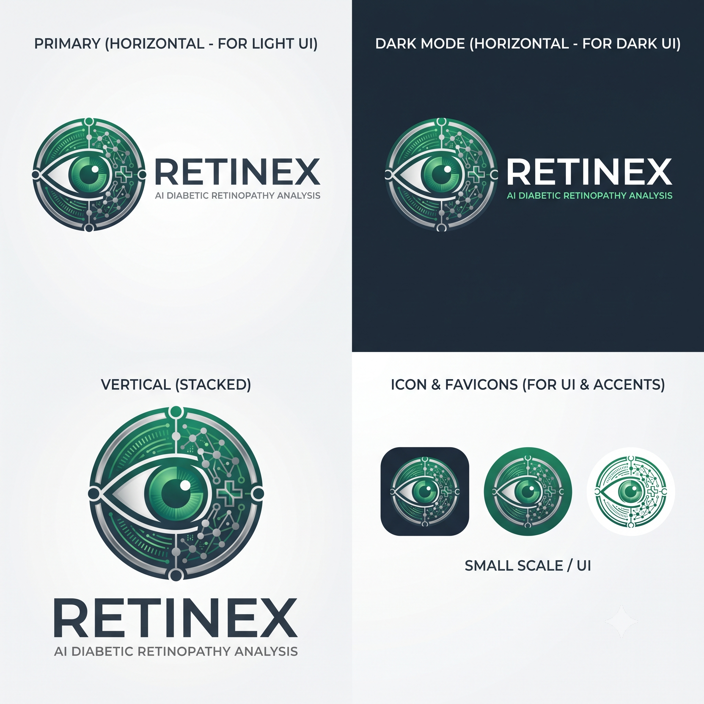

# RetinEx — AI-Assisted Diabetic Retinopathy Screening Platform

<p align="center">
  
</p>

<p align="center">
  <strong>An end-to-end clinical diagnostic instrument and triage platform for early Diabetic Retinopathy (DR) screening.</strong>
</p>

---

## 📌 Overview

**RetinEx** is an AI-assisted diabetic retinopathy screening platform developed to transform walk-in patient triage. It accelerates the journey from patient registration and retinal fundus imaging to doctor-validated clinical diagnosis and multi-language patient reporting.

The system is organized around four distinct user portals:

- **🔬 Technician Portal**: Streamlined patient intake, retinal fundus image capture (Left Eye / OS and Right Eye / OD), automated image quality feedback (adequate / borderline / reject), and case dispatch.
- **🩺 Doctor Portal**: Clinical diagnostic workstation featuring AI severity grades (0–4), explainable Grad-CAM heatmaps, pixel-level lesion segmentation (hard exudates, hemorrhages, microaneurysms, soft exudates), retinal vessel masks, and report finalization.
- **👤 Patient Portal**: Mobile-friendly access for patients to track their screening status, review doctor-signed reports, access translations, and listen to audio report summaries.
- **🛡️ Admin Portal**: System-wide operational dashboard for staff user management, role assignments, audit logging, and clinic-level screening metrics.

---

## 🏗️ Architecture & Tech Stack

```text
┌────────────────────────────────────────────────────────┐
│             Frontend (React + Vite + TS)               │
│      Technician  │  Doctor  │  Patient  │  Admin       │
└───────────────────────────┬────────────────────────────┘
                            │ REST API (JWT)
┌───────────────────────────▼────────────────────────────┐
│         Backend Server (Node.js + Express.js)          │
│               MongoDB Database (Mongoose)              │
└─────────────┬───────────────────────────┬──────────────┘
              │                           │
┌─────────────▼──────────────┐ ┌──────────▼──────────────┐
│   MATLAB Quality Engine    │ │  Python PyTorch Pipeline│
│ • Blur/Illumination checks │ │ • EfficientNet-B0 (DR)  │
│ • Optic Disc & Fovea Loc   │ │ • U-Net Lesion & Vessel │
│ • Quality verdict (JSON)   │ │ • Grad-CAM Overlays     │
└────────────────────────────┘ └─────────────────────────┘
```

### 1. Frontend (`app/`)
- **Framework**: React 18+ with Vite and TypeScript
- **Styling**: Tailwind CSS with custom glassmorphism design system
- **Routing**: React Router with dedicated role-based layouts (`TechnicianLayout`, `DoctorLayout`, `PatientLayout`, `AdminLayout`)
- **State & Assets**: Lucide Icons, Canvas/SVG fundus overlays, responsive report generator

### 2. Backend (`backend/`)
- **Runtime**: Node.js & Express.js
- **Database**: MongoDB with Mongoose ODM (`User`, `Patient`, `Visit`, `Result`)
- **Authentication**: JWT Bearer Tokens with bcrypt password hashing
- **File & Pipeline Management**: Multer multipart upload, sequential process orchestrator for MATLAB and Python AI pipelines, static asset server for generated heatmaps and segmentation overlays

### 3. Image Quality Assessment & Localization (`MATLAB/`)
- **Quality Engine**: Automated illumination, blur, and field-of-view (FOV) assessment
- **Anatomy Localization**: Automated localization of optic disc center and foveal coordinates
- **Integration**: `runRetinExJSON.m` CLI wrapper producing structured JSON reports

### 4. Deep Learning AI Pipeline (`RetinEx-Model/`)
- **Framework**: Python 3.9+, PyTorch, Torchvision
- **DR Severity Classifier**: Fine-tuned EfficientNet-B0 predicting 5-class DR severity (Grade 0–4) and referable-DR probability
- **Lesion Segmentation**: Multi-class U-Net segmenting Microaneurysms (MA), Hemorrhages (HE), Hard Exudates (EX), and Soft Exudates (SE)
- **Vessel Segmentation**: Dedicated retinal vasculature segmentation network
- **Explainability**: Gradient-weighted Class Activation Mapping (Grad-CAM)

---

## 📊 Model Performance (IDRiD Benchmark)

| Metric | Score | Clinical Context |
|---|---|---|
| **Referable-DR Sensitivity (Grade ≥ 2)** | **85.9%** | Identifies patients requiring specialist intervention |
| **Referable-DR Specificity** | **82.1%** | Minimizes unnecessary referrals |
| **ROC-AUC (Referable-DR)** | **0.920** | High discriminatory ability on IDRiD test dataset |
| **Vessel Segmentation Dice** | **0.74** | Robust vasculature mapping |
| **Hard Exudates (EX) Dice** | **0.52** | High diagnostic utility for macular edema indicators |

---

## 📁 Repository Structure

```text
.
├── app/                  # Frontend application (React + Vite + TypeScript)
│   ├── src/              # Pages, components, layouts, contexts, hooks
│   ├── package.json      # Frontend dependencies
│   └── vite.config.ts    # Vite configuration
├── backend/              # Node.js API server
│   ├── middleware/       # Auth, upload, and error middleware
│   ├── models/           # Mongoose schemas (User, Patient, Visit, Result)
│   ├── index.js          # Server entry point and API route definitions
│   └── package.json      # Backend dependencies
├── documents/            # Detailed technical specs and documentation
│   ├── API_ROUTES.md     # Backend REST API endpoint documentation
│   ├── DATABASE_SCHEMA.md# MongoDB schema details
│   ├── DESIGN_SYSTEM.md  # UI and styling guidelines
│   ├── PRD.md            # Product Requirements Document
│   ├── ROADMAP.md        # Feature roadmap and milestones
│   └── USER_FLOW.md      # Role-based user journey flows
├── MATLAB/               # MATLAB scripts for image quality and anatomical localization
│   └── code/             # MATLAB source and CLI entry points
├── RetinEx-Model/        # Deep learning models, training scripts, and inference pipeline
├── DESIGN.md             # Aesthetic philosophy and design guidelines
├── RetinEx_Full_Handoff.md # Comprehensive engineering handoff document
└── RetinexLogo.png       # Platform logo
```

---

## 🚀 Getting Started

### Prerequisites
- **Node.js** (v18+) & **npm**
- **Python** (v3.9+) with PyTorch and CUDA (optional for GPU acceleration)
- **MongoDB** (local or MongoDB Atlas connection string)
- **MATLAB** (optional: set `USE_MOCK_MATLAB=true` in `.env` if running without local MATLAB runtime)

---

### 1. Backend Setup

```bash
cd backend

# Install dependencies
npm install

# Configure environment variables
cp .env.example .env
# Edit .env with your MongoDB URI, JWT_SECRET, and python/matlab paths

# Start the backend server
node index.js
```
The server will start listening on `http://localhost:3000`. Test health status at `http://localhost:3000/health`.

### 2. Frontend Setup

```bash
cd app

# Install dependencies
npm install

# Start Vite development server
npm run dev
```
The application will be accessible at `http://localhost:5173`.

---

## 🔐 Default Test Credentials

For development and evaluation, the backend seed script includes:

- **Doctor Login**: `doctor@retinex.com`
- **Password**: `RetinEx@2026`

---

## 📖 Extended Documentation

Refer to the [`documents/`](documents/) directory for in-depth engineering documentation:
- [API Routes](documents/API_ROUTES.md)
- [Database Schema](documents/DATABASE_SCHEMA.md)
- [Design System](documents/DESIGN_SYSTEM.md)
- [Product Requirements (PRD)](documents/PRD.md)
- [User Journey Flows](documents/USER_FLOW.md)
- [Engineering Status Handoff](RetinEx_Full_Handoff.md)

---

## 📄 License

This project is licensed under the MIT License.
